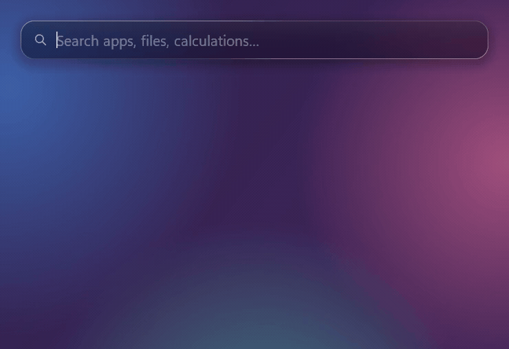
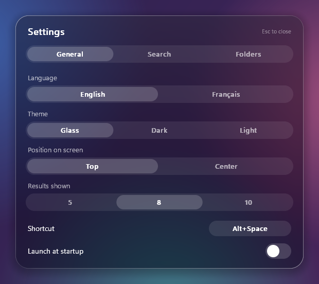

<p align="center">
  
</p>

<h1 align="center">Lense</h1>

<p align="center">A Spotlight-style keyboard launcher for Windows 11 — apps, files, maths and the web, one shortcut away.</p>

<p align="center">
  
</p>

Press **Alt+Space**, type a few letters, press **Enter**. Lense finds your apps, your files, does quick maths and
unit conversions, and falls back to a web search. It lives in the notification area, opens in about 20 ms and uses
about 4 MB of RAM while it waits.

Built with Rust and `windows-sys` only: no framework, no WebView, no runtime to install. The Liquid Glass look is
rendered on the CPU.

## Features

- **Apps**: Start menu shortcuts, Microsoft Store apps, taskbar pins, and any `.exe` you add.
- **Fuzzy search**: ignores case and accents, understands abbreviations (`vsc` → Visual Studio Code) and typos
  (`crhome` → Chrome).
- **Frecency**: what you open often and recently comes first.
- **Files**: in the folders you choose, with a local index kept up to date live.
- **Calculator**: `12*4+3`, `(3.5+1)/2`, `2^10`, `sqrt 2` — Enter copies the result.
- **Unit conversions**: `10 km in mi`, `-40 c to f`, `1 GB in MB`, `72 f`.
- **Web search** when nothing matches (Google, DuckDuckGo, Bing, Ecosia, or any engine).
- **Settings panel**: language (English / Français), theme (glass, dark, light), position, number of results,
  shortcut, search options, indexed folders.

<p align="center">
  
</p>

## Keyboard

| Key | Action |
|---|---|
| **Alt+Space** | open / close (change it in Settings) |
| Esc, click outside | close |
| ↑ ↓ · Ctrl+K / Ctrl+J | previous / next result |
| Enter | open (maths: copy; web: search) |
| Ctrl+Enter | show in its folder |
| Shift+Enter | run as administrator |
| Ctrl+C | copy the result or the path |
| Ctrl+, | settings |

### Alt+Space, PowerToys Run and the window menu

Alt+Space normally opens the window menu. While Lense runs, Lense gets it instead; the window menu is still a
right-click away on any title bar. If Alt+Space is already taken (PowerToys Run uses it by default), Lense falls back
to **Ctrl+Alt+Space** and tells you. Pick any shortcut in Settings: click it, then press the new combination.

## Install

You need [Rust](https://rustup.rs) (target `x86_64-pc-windows-gnu`; with MSVC the exe simply has no icon).

```bash
cargo build --release
```

Run `target\release\lense.exe`: the icon appears in the notification area. Its menu has **Settings**,
**Rebuild index**, **Launch at startup** and **Quit**.

## Settings

Everything is in the Settings panel (tray menu, or Ctrl+, in Lense). It writes `%LOCALAPPDATA%\Lense\settings.txt`,
which you can also edit by hand for the advanced keys:

```ini
hotkey=Alt+Space
language=en                           # en or fr
theme=glass                           # glass, dark or light
position=top                          # top or center
rows=8                                # 5, 8 or 10
files=1
typos=1
calc=1
web=1
roots=Desktop;Documents;Downloads     # indexed folders: these three names or paths (%USERPROFILE%… works)
ignore=.git;node_modules;target;.venv;__pycache__
pinned=                               # .exe files to add to the apps, separated by ;
engine=https://www.google.com/search?q=%s
```

## Your data

Everything stays on your PC, in `%LOCALAPPDATA%\Lense\`:

| File | What |
|---|---|
| `settings.txt` | the settings above |
| `history.txt` | what you opened (path, count, date), for frecency — clear it in Settings |
| `files.idx` | the file names of the indexed folders |

Lense sends nothing over the network. The only way out is the web search, when you choose it, in your browser.

## Performance

Measured with `lense.exe --bench` (125 % display scale, ~40,000 indexed files):

| | Target | Measured |
|---|---|---|
| Window opens | < 50 ms | ~20 ms |
| Results per keystroke | < 16 ms | p50 5 ms, p99 < 15 ms |
| RAM while hidden | < 30 MB | ~4 MB |
| CPU while hidden | ~0 % | 0 % (threads blocked waiting) |

## Code

```
src/
  main.rs      launcher window, shortcut, notification area, keyboard, result list
  prefs.rs     settings panel
  paint.rs     drawing on top of the glass (shapes, icons, text)
  render.rs    Liquid Glass engine (from DESKTOUCH / Deskorb)
  win.rs       text, background capture, icons, menu, clipboard
  settings.rs  settings.txt, launch at startup, web search
  apps.rs      app index, icons, launching
  files.rs     file index, files.idx, live watching
  fuzzy.rs     fuzzy matching
  history.rs   frecency
  calc.rs      maths and unit conversions
```

`cargo test` runs the tests (ranking, maths, index format, settings).

## Later

System commands (lock, sleep, empty the recycle bin), clipboard history, extensions, browser tabs, Everything as an
optional file backend.

---

## En français

Lense est un lanceur clavier pour Windows 11, façon Spotlight. **Alt+Espace**, quelques lettres, **Entrée** : apps,
fichiers, calculs (`12*4+3`), conversions (`10 km en mi`, `1 Go en Mo`) et recherche web. L'interface est en anglais
par défaut ; passez-la en **français** dans Paramètres → Langue. Toutes les données restent sur votre PC, dans
`%LOCALAPPDATA%\Lense\`.
